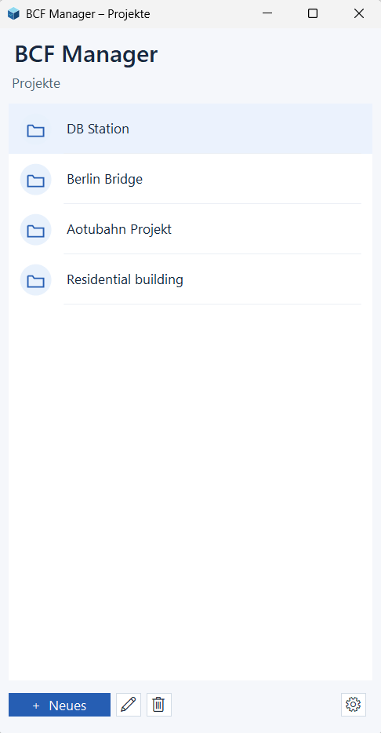

# BCF Manager

[**⬇ Download BCF Manager for Windows**](https://github.com/Kinanqazan/BCF-Manager/releases/latest/download/BCF-Manager-Portable.zip)

*Portable app · No installation needed · Includes camera recognition*

Spot an issue in Navisworks Freedom, capture its model view, and keep the discussion with the issue. BCF Manager adds a simple project and issue list alongside Freedom, with BCF exchange and PDF reports.

| Projects | BCF Manager beside Navisworks Freedom |
|:--:|:--:|
|  |  |

## Get started

1. Download the ZIP above.
2. Extract the complete folder to a place you can write to, such as Documents.
3. Double-click `BCF-Manager.exe` and open your model in Navisworks Freedom.

> **Windows SmartScreen:** The app is currently unsigned, so Windows may display a warning on first launch. If you downloaded it from this repository’s official Releases and trust the source, select **More info → Run anyway** (*Weitere Informationen → Trotzdem ausführen*).

Keep the extracted folder together. Your projects and issues are stored in its `data` folder. To move the app and your data to another computer, copy the whole folder.

## Made for everyday model reviews

- Capture screenshots and camera views from Navisworks Freedom.
- Organize issues by project, status, and assigned person.
- Add comments and share issues as BCF files.
- Export clear PDF reports.

BCF Manager runs beside Navisworks Freedom and keeps your project data on your computer.

## For developers: build and package from source

Clone this repository on Windows, open PowerShell in the cloned folder, and run:

```powershell
.\build.ps1
```

The script builds `BCF-Manager.exe` and creates `dist\BCF-Manager-Portable.zip`. The ZIP contains the app and its OCR files; it does not include the local `data` folder or your issues.

To publish a new downloadable version after pushing your source changes, use the next unused version tag. For example:

```powershell
git tag v1.0.1
git push origin v1.0.1
```

GitHub Actions will build the ZIP from that tagged source and attach it to a GitHub Release. The ZIP is kept as a release download, separate from the editable source files.
