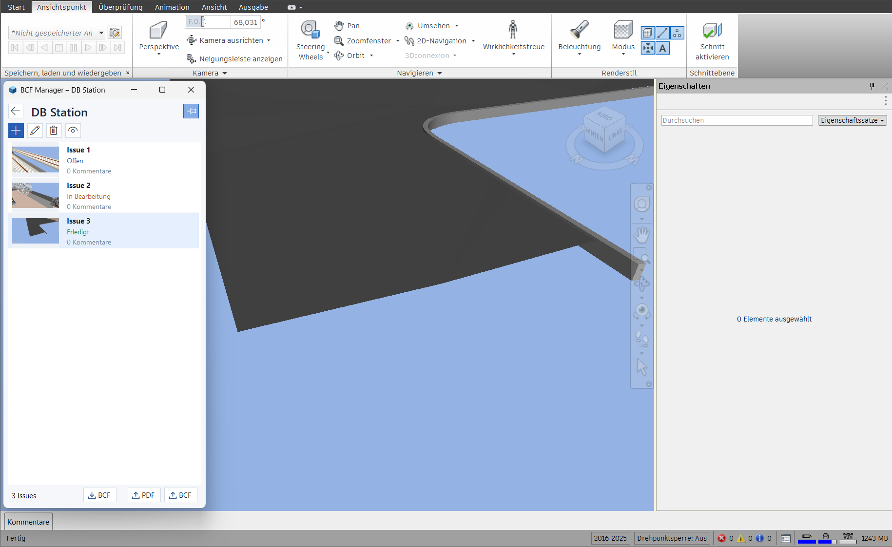

# BCF Manager

[**⬇ Download BCF Manager for Windows**](https://github.com/Kinanqazan/BCF-Manager/releases/latest/download/BCF-Manager-Portable.zip)

*Portable app · No installation needed · Includes camera recognition*

Spot an issue in Navisworks Freedom, capture its model view, and keep the discussion with the issue. BCF Manager adds a simple project and issue list alongside Freedom, with BCF exchange and PDF reports.

## Get started

1. Download the ZIP above.
2. Extract the complete folder to a place you can write to, such as Documents.
3. Double-click `BCF-Manager.exe` and open your model in Navisworks Freedom.

Keep the extracted folder together. Your projects and issues are stored in its `data` folder. To move the app and your data to another computer, copy the whole folder.

## Made for everyday model reviews

- Capture screenshots and camera views from Navisworks Freedom.
- Organize issues by project, status, and assigned person.
- Add comments and share issues as BCF files.
- Export clear PDF reports.

BCF Manager runs beside Navisworks Freedom and keeps your project data on your computer.

